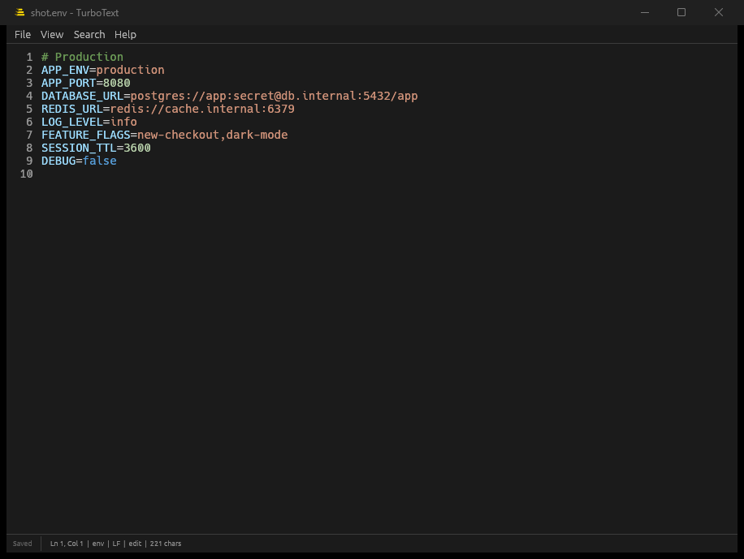
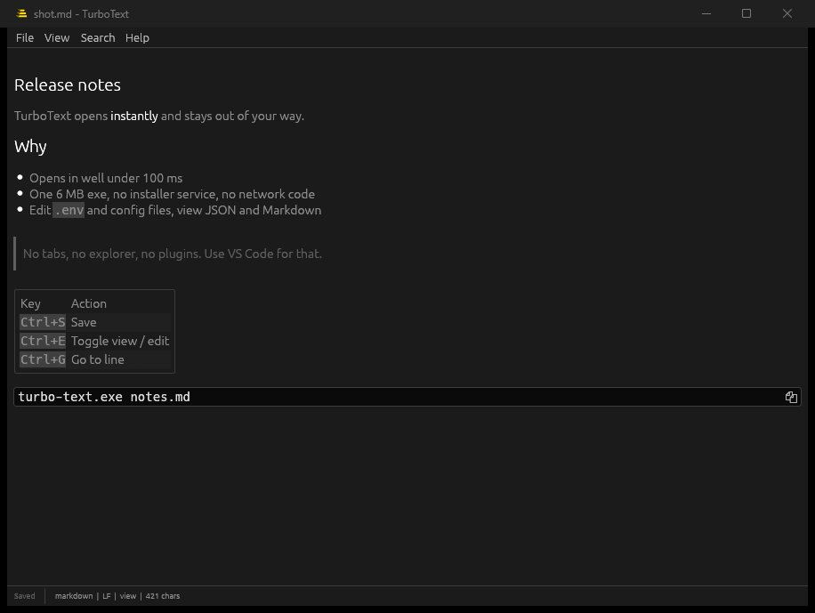
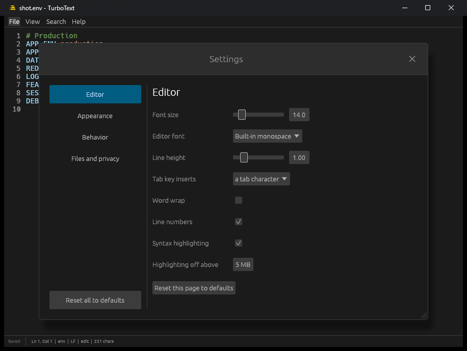

# TurboText

Tiny, fast, single-file editor/viewer for Windows. Built for quick edits to `.env` and config files, viewing JSON, and viewing/editing Markdown. No tabs, no explorer, no plugins: use VS Code for that.



Rust + [egui](https://github.com/emilk/egui). The release exe is about 6 MB, the window opens in well under 100 ms, and the app has no network code.

## Install

Windows 10/11, 64-bit. No admin rights needed.

**From a release:** download `turbo-text-vX.Y.Z-x86_64.zip` from the [Releases](https://github.com/hieuuk/turbo-text/releases) page, check it against the `.sha256` file, unzip, and run:

```
turbo-text.exe --install
```

This copies the exe to `%LOCALAPPDATA%\Programs\TurboText`, adds a Start Menu shortcut, adds TurboText to "Open with" for common config and text extensions (list editable in Settings), and adds an entry to Apps & features. `turbo-text.exe --uninstall` (or Apps & features) removes it again and keeps your settings. Or skip installing and just run the exe from anywhere.

**From source:** `cargo build --release` (Rust 1.88 or newer); the exe is `target/release/turbo-text.exe`.

The exe is not code-signed, so Windows SmartScreen may warn "unknown publisher" the first time (More info > Run anyway), and some antivirus tools flag unsigned Rust GUI programs. The source is all here and releases are built by the workflow in `.github/workflows`.

## Usage

```
turbo-text.exe [file]
turbo-text.exe --install | --uninstall        # per-user install, see above
turbo-text.exe --associate .env .json .md     # register as "Open with" handler (current user, no admin)
turbo-text.exe --unassociate .env
turbo-text.exe --stats [--clear]              # summarize or wipe the local usage log
turbo-text.exe --version | --help
```

One file per window. Open another file with `Ctrl+O` or drag it onto the window; `Ctrl+N` opens a blank window. Opening a path that doesn't exist starts a new file that is created on save. If the file changes on disk, a clean buffer reloads by itself and a buffer with unsaved edits asks first (Reload or Keep mine); your edits are never overwritten silently.

| Key | Action |
|---|---|
| `Ctrl+S` / `Ctrl+Shift+S` | Save (atomic: temp file + rename; keeps CRLF/LF) / Save as |
| `Ctrl+O` / `Ctrl+N` | Open / New window |
| `Ctrl+E` | Toggle view / edit |
| `Ctrl+F` / `Ctrl+H` | Find / find and replace (plain text, optional match case) |
| `Ctrl+G` | Go to line |
| `Ctrl +` / `Ctrl -` / `Ctrl 0` | Zoom in / out / reset (also `Ctrl` + mouse wheel); changes `font_size` |
| `Alt+Z` | Toggle word wrap |
| `Ctrl+,` | Settings |



`.json` and `.md` open in view mode (collapsible tree / rendered Markdown). Everything else opens in the editor with syntax highlighting and line numbers. Invalid JSON shows the error with line and column. Files that are not valid UTF-8 open read-only so they can't be corrupted. Files over `large_file_mb` (5 by default) open without highlighting.

## Settings



Open **File > Settings…** (`Ctrl+,`). A sidebar switches between Editor, Appearance (colour themes), Behavior and Files and privacy. Changes apply instantly and are saved automatically; each page has "Reset this page to defaults" and the sidebar has "Reset all to defaults". The file is `%APPDATA%\turbo-text\settings.toml` (File > Open settings file) and can also be edited by hand: every key is validated on its own, so an invalid or out-of-range value falls back to that key's default and never affects the others.

| Key | Values (default) | Applies |
|---|---|---|
| `font_size` | 6-72 (14) | live |
| `line_height` | 0.8-2.0 (1.0): row height as a multiple of the font's natural row height, in the editor and the Markdown view | live |
| `editor_font`, `view_font` | `monospace`, `proportional`, or a Windows font: `consolas`, `cascadia-code`, `cascadia-mono`, `courier-new`, `lucida-console`, `segoe-ui`, `arial`, `calibri`, `verdana`, `tahoma`, `georgia`, `times-new-roman` (monospace / proportional). The view font is the Markdown view's body text. Fonts are read from `C:\Windows\Fonts` only when selected | live |
| `wrap`, `show_line_numbers`, `highlight` | bool (false, true, true) | live |
| `tab_spaces` | 0 = tab character, 2, 4, 8 (0) | live |
| `large_file_mb` | 1-100 (5): highlighting turns off above this size | live |
| `theme` | `system` (follow Windows), `dark`, `light`, `dracula`, `tokyo-night`, `catppuccin-mocha`, `nord`, `gruvbox-dark`, `solarized-dark`, `one-dark`, `monokai`, `solarized-light`, `catppuccin-latte` (system) | live |
| `ui_scale` | 0.75-2.0 (1.0) | live |
| `open_json`, `open_markdown`, `open_other` | `view` / `edit` (view, view, edit) | next file opened |
| `confirm_close` | bool (true): ask before closing with unsaved changes | live |
| `remember_window`, `window_w`, `window_h` | bool (true), size in 300-10000 | next launch |
| `assoc_exts` | list of extensions offered for association | on Apply |
| `telemetry`, `telemetry_max_kb`, `telemetry_max_days` | false, 2048, 90 | next launch |

Default association list: `.env .json .md .toml .ini .yaml .yml .txt .log .conf .cfg .config .properties .gitignore .editorconfig .csv .xml`. Add or remove entries in the settings dialog (Files and privacy), tick the ones you want and press "Apply associations".

## Usage log (local only)

The usage log is off by default. With `telemetry = true` (Settings > Files and privacy), TurboText appends small JSON events to `%APPDATA%\turbo-text\usage.jsonl`: startup time, formats and size buckets opened, feature use, view vs edit time per format, and problems. It never records file contents, keystrokes, or file names (paths are stored as extension plus a salted hash), and nothing leaves your machine. The log rotates at `telemetry_max_kb` (old events beyond `telemetry_max_days` are dropped), so it stays under about twice that size. Use `--stats` to read it, or the buttons in Settings > Files and privacy to open or clear it.

## File associations

`--associate` (or Settings > Files and privacy > Apply associations) registers TurboText under `HKCU\Software\Classes` and sets itself as an extension's default only when none exists. Windows keeps the default-app choice behind a confirmation, so the Default apps settings page opens afterwards.

## Build

```
cargo build --release
cargo test
```

See [CONTRIBUTING.md](CONTRIBUTING.md). Changes are listed in [CHANGELOG.md](CHANGELOG.md).

## License

GPL-3.0-only, see [LICENSE](LICENSE). The vendored `vendor/egui_commonmark_backend` keeps its own MIT/Apache-2.0 licenses.
